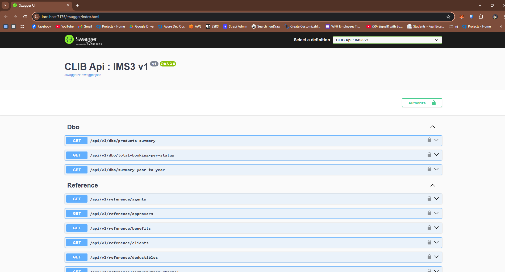
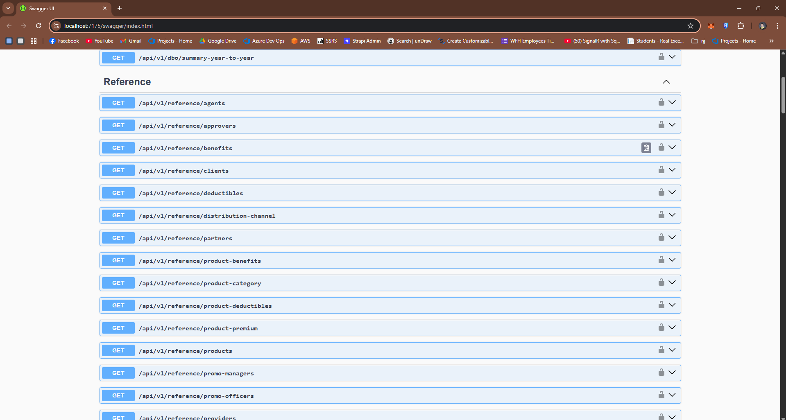
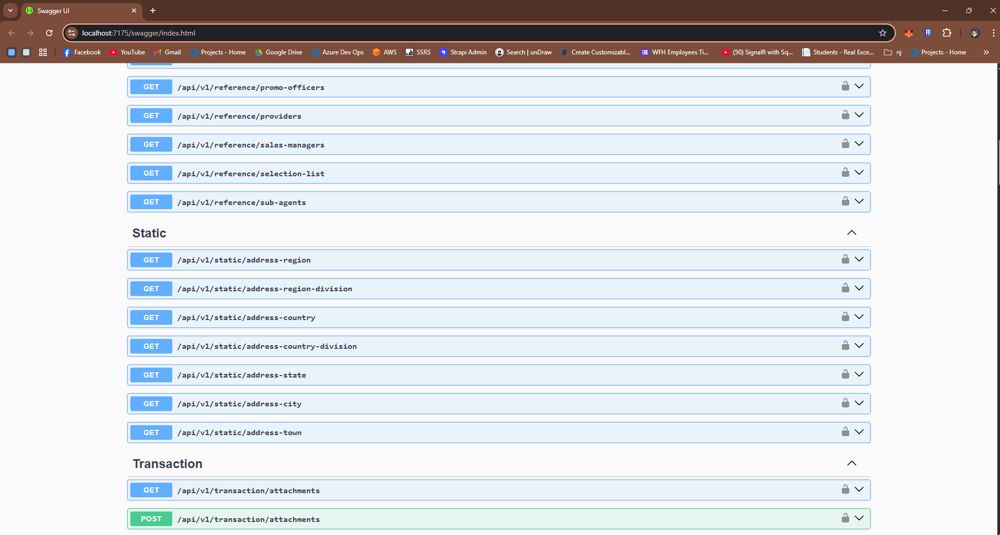
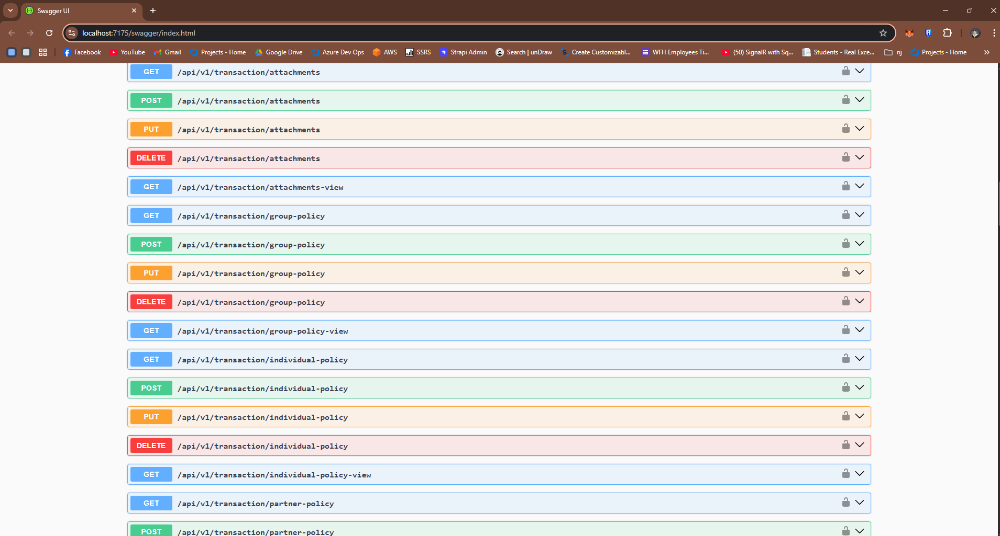
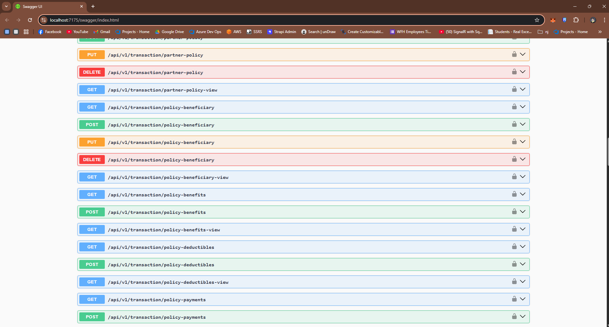
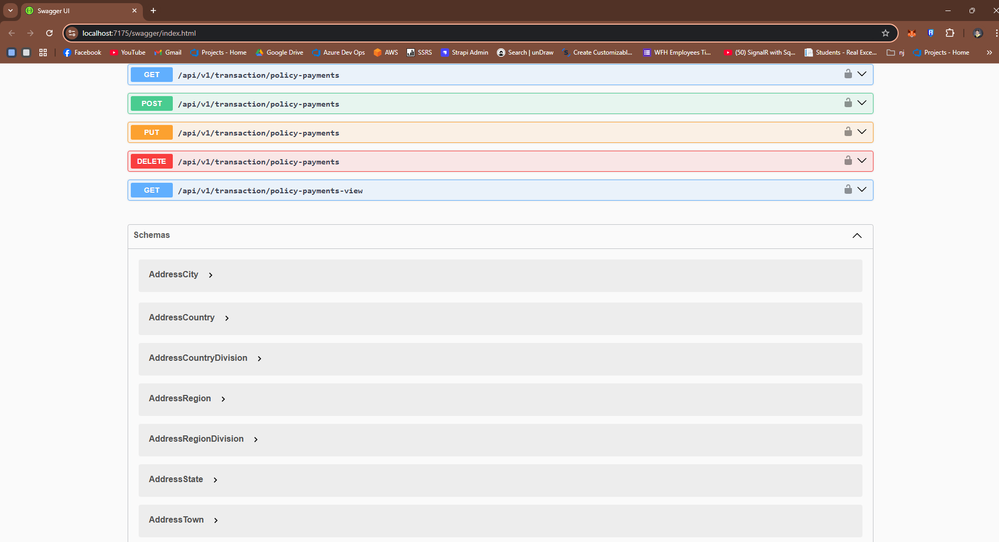

<div align="center">

# 💻 DJDPatricio Insurance Management System (IMS) API

**Sample project showcasing a basic API implementation for an Insurance Management System.**

![C#][b-lang] ![.NET 8][b-framework] ![Tests][b-tests] ![Year][b-year] ![License][b-license]

</div>

---

## 📖 About

This is a practice and learning project built with C# and ASP.NET Core Web API on .NET 8, focused on the core structure of an Insurance Management System.

It demonstrates essential concepts in modern API development, including layered architecture, clean coding standards, and key features like authentication, data handling, and policy management. All data access goes through ADO.NET and SQL Server stored procedures, and every endpoint is versioned under `/api/v1/...`.

Designed for experimentation and foundational training, this project serves as a starting point for developing more robust, production-ready insurance applications.

---

## 🔥 Tech Stack & Tools

<p align="center">
  
  
  
  
  
  <br />
  
  
  
  
  
  <br />
  
  
</p>

- **API:** ASP.NET Core Web API on .NET 8 (`net8.0`), REST controllers, URL segment API versioning (`/api/v1/...`)
- **Data access:** ADO.NET with `Microsoft.Data.SqlClient`, stored procedures only (no ORM)
- **Database:** SQL Server 2019 or later, LocalDB or Azure SQL Database
- **Security:** JWT bearer authentication, CORS policy
- **Documentation and logging:** Swagger UI (Swashbuckle), Serilog daily rolling file logs (UTC timestamps)
- **Testing:** xUnit with Moq, 332 passing unit tests covering every controller with mock data

<details>
<summary>📦 NuGet packages</summary>

**DJDPatricio.IMS.API**

| Package | Version | Used for |
| :-- | :-- | :-- |
| Asp.Versioning.Mvc | 8.1.0 | API versioning |
| Asp.Versioning.Mvc.ApiExplorer | 8.1.0 | versioned Swagger documents |
| Microsoft.AspNetCore.Authentication.JwtBearer | 8.0.17 | JWT bearer authentication |
| Microsoft.Data.SqlClient | 6.0.2 | SQL Server ADO.NET driver |
| Serilog.Sinks.File | 7.0.0 | file logging |
| Swashbuckle.AspNetCore | 9.0.1 | Swagger / OpenAPI UI |
| System.IdentityModel.Tokens.Jwt | 8.12.1 | JWT handling |

**DJDPatricio.IMS.TESTS**

| Package | Version | Used for |
| :-- | :-- | :-- |
| xunit | 2.5.3 | test framework |
| xunit.runner.visualstudio | 2.5.3 | test runner |
| Microsoft.NET.Test.Sdk | 17.8.0 | test host |
| Moq | 4.20.72 | mocking services |
| coverlet.collector | 6.0.0 | code coverage |

</details>

---

## ✨ Features

### 🧱 API & Service Foundations
- **Architectural Principles:** Layered Architecture (Controllers, Services, Repositories), Object-Oriented Programming (OOP), SOLID Principles
- **Core API Design:** Dependency Injection, API Versioning, JWT Authentication, Request Validation, CORS Handling

### 🗄️ Data Management & Interaction
- **Database Abstraction:** DB Wrapper, API DB Factory Wrapper
- **Database Design & Structure:**
  - **Schema & Constraints:** Primary Keys, Foreign Keys, Unique Constraints, Normalization, Column/Field Standardization
  - **Programmability:** Stored Procedures, Functions, Views, Sequences, Procedure Return Results
  - **Performance & Efficiency:** Query Optimization, Pagination, Indexing, UTC Time Saving

### ⚙️ Operational Excellence
- **Monitoring & Reliability:** API Logging (Serilog), Timeout Handling
- **Configuration:** Environment variables override `appsettings` (for example `ConnectionStrings__DefaultConnection`)

### 🧼 Code Quality & Standards
- **Development Practices:** Clean Code, Maintainability First
- **Resource Management:** Constants, Static Data, Static Messages

### 🧪 Development Workflow & Testing
- **Documentation & Testing:** API Documentation (Swagger), Unit Tests (332 passing), Mock Data for Testing
- **Deployment Readiness:** Docker Prepared (container launch profile on ports 8080/8081)

---

## 📚 Modules

1. 🧑‍💼 Agents
2. 🧑‍💼 Sub-Agents
3. 📣 Promo Managers
4. 📊 Sales Managers
5. 🕵️ Promo Officers
6. 🤝 Partners
7. 👤 Clients
8. 🏢 Providers
9. 🔀 Distribution Channels
10. 🗂️ Product Categories
11. 📦 Products
12. 📘 **Policy Components:**
    - 💠 Benefits
    - 🛡️ Deductibles
    - 💰 Premiums
    - 👨‍👩‍👧 Beneficiary
    - 💳 Payments
    - 📎 Attachments
13. 🔄 **Policy Booking CRUD Operations:**
    - 🧾 Individual Policy Booking
    - 🏢 Partner Policy Booking
    - 👥 Group Policy Booking
14. 📈 **Dashboards:** products summary, bookings per status, year-to-year summary
15. 🌏 **Static Address Data:** countries, regions, states, cities and towns

The endpoints are grouped into four versioned controllers: `dbo` (dashboards), `reference` (people, partners, products and lookups), `static` (addresses) and `transaction` (policy bookings and components).

---

## 🗄️ Database

The full database script is [`Database/djdpatricio_ims.sql`](Database/djdpatricio_ims.sql), and it is also attached to the [v1.0 release](https://github.com/djdpatricio/djdpatricio_2025-csharp-aspnetwebapi/releases).

- Targets SQL Server 2019 or later, or Azure SQL Database. All audit timestamps are UTC.
- Builds 41 tables in the `Static`, `Reference`, `Transaction` and `dbo` schemas, with 101 foreign keys, 26 unique constraints, 48 indexes, 9 views, 9 functions, 4 sequences and 59 stored procedures.
- Seeds every unit test mock row, plus generated demo data: Philippine regions, cities and barangays, 300+ clients, agents and managers, 50 partners, 35 providers, 152 products and about 500 policy bookings over the last three years, so the dashboards have data.
- Safe to re-run: existing tables and rows are kept, and programmable objects are recreated.

---

## 🗂️ Project Structure

```text
djdpatricio_2025-csharp-aspnetwebapi/
├── DJDPatricio.IMS.sln
├── Database/
│   └── djdpatricio_ims.sql      schema, stored procedures and seed data
├── DJDPatricio.IMS.API/
│   ├── Controllers/             Dbo, Reference, Static and Transaction (v1)
│   ├── Service/                 service interfaces and implementations (V1)
│   ├── Repository/              stored procedure calls, DB factory wrapper, procedure names
│   ├── Models/                  config, request (Post/Put) and result models
│   ├── Helpers/                 config, logging, messages, static data, validation
│   ├── Properties/              launchSettings.json (http, https, IIS Express, Docker)
│   ├── appsettings.json
│   ├── appsettings.Development.json
│   └── Program.cs
├── DJDPatricio.IMS.TESTS/
│   ├── Controllers/             xUnit tests per controller
│   └── MockData/                mock data for Dbo, Reference, Static and Transaction
├── scripts/
│   ├── run-local.ps1            one command: create the LocalDB database, print a token, run the API
│   └── new-dev-token.ps1        create a development JWT signed with the local key
├── docs/screenshots/            system_image_1.png to system_image_6.png
├── LICENSE
└── README.md
```

---

## 🛠 Requirements

- .NET 8 SDK or later (newer SDKs can run it with `DOTNET_ROLL_FORWARD=Major`)
- SQL Server 2019 or later, SQL Server LocalDB, or Azure SQL Database
- Visual Studio 2022 or VS Code

---

## 🔑 Default Authentication

> You can decode and verify this JWT at [jwt.io](https://jwt.io/)

### 📌 Header

```json
{
  "alg": "HS256",
  "typ": "JWT"
}
```

### 📦 Payload

```json
{
  "sub": "500329",
  "name": "John Doe",
  "role": "Sales Agent",
  "iss": "http://localhost:7175",
  "aud": "djdpatricio.ims.api",
  "exp": 1893456000
}
```

### ✍️ Signature

```
83afd726d5595c1eb62f0e5c839f52581b6ad0d13e4c6087ca8b764ab2c8409b
2401240e69236d1ef65bf76fa22ad731d8e252d585de3369c5b5545bdf9a6e6d
```

> 🎟️ The header, payload and signature above explain the token; they are not a token you can paste. Create a ready-to-use one, signed with the local key and valid for 7 days, with:
> ```powershell
> pwsh scripts/new-dev-token.ps1
> ```
> Options: `-Days 30`, `-UserId`, `-Name`, `-Role`.

> ⚠️ The signing key (`Authentication:JwtKey` in `appsettings.Development.json`) is for local development only. Replace it with a secret, for example an environment variable or a key vault, before any production use.

---

## ▶️ How to Run

### ⚡ Quick start (Windows, one command)

Needs the .NET SDK, Sqlcmd and SQL Server LocalDB (see Requirements).

```powershell
git clone https://github.com/djdpatricio/djdpatricio_2025-csharp-aspnetwebapi.git
cd djdpatricio_2025-csharp-aspnetwebapi
pwsh scripts/run-local.ps1
```

It creates the `djdpatricio_ims` database on LocalDB if it is missing, prints a token valid for 7 days, starts the API on port 5212 and opens Swagger. In Swagger click **Authorize** and paste the token (without the word `Bearer`). Add `-ResetDatabase` to rebuild the database from scratch, `-Port <n>` for another port, or `-NoBrowser` to skip opening the browser. Stop the API with `Ctrl+C`.

### 🧭 Step by step (any SQL Server)

1. Clone the repo:
   ```bash
   git clone https://github.com/djdpatricio/djdpatricio_2025-csharp-aspnetwebapi.git
   cd djdpatricio_2025-csharp-aspnetwebapi
   ```
2. Execute the database script: [Database Script](Database/djdpatricio_ims.sql) 📄 (also attached to the [v1.0 release](https://github.com/djdpatricio/djdpatricio_2025-csharp-aspnetwebapi/releases)). With LocalDB:
   ```bash
   sqlcmd -S "(localdb)\MSSQLLocalDB" -E -b -I -i Database\djdpatricio_ims.sql
   ```
   Or open the script in SSMS or Azure Data Studio and run it.
3. On a hosted database (Azure SQL), create the empty database first, then run the script without the block marked `SKIP ON A HOSTED DATABASE` at the top.
4. Update the connection string to match your connection details, either in `DJDPatricio.IMS.API/appsettings.Development.json`:
   ```json
   "ConnectionStrings": {
     "DefaultConnection": "Server=localhost;Database=djdpatricio_ims;TrustServerCertificate=True;Trusted_Connection=True;"
   },
   ```
   or with the environment variable `ConnectionStrings__DefaultConnection`, which overrides `appsettings`.
5. Run the API:
   ```bash
   dotnet run --project DJDPatricio.IMS.API
   ```
   On a machine with only a newer .NET SDK, set `DOTNET_ROLL_FORWARD=Major` first.
6. Open Swagger at [http://localhost:5212/swagger](http://localhost:5212/swagger), click **Authorize** and paste a token from `pwsh scripts/new-dev-token.ps1` (without the word `Bearer`).
7. Run the unit tests (mock data, no database needed):
   ```bash
   dotnet test DJDPatricio.IMS.sln
   ```

---

## 🖼️ Gallery

Here are some screenshots of the DJDPatricio Insurance Management System API in action:

<table>
  <tr>
    <td align="center" width="50%"><br /><sub>Swagger UI with the Dbo dashboard endpoints</sub></td>
    <td align="center" width="50%"><br /><sub>Reference endpoints</sub></td>
  </tr>
  <tr>
    <td align="center" width="50%"><br /><sub>Reference and Static address endpoints</sub></td>
    <td align="center" width="50%"><br /><sub>Transaction endpoints: attachments, group and individual policies</sub></td>
  </tr>
  <tr>
    <td align="center" width="50%"><br /><sub>Transaction endpoints: partner policy, beneficiary, benefits, deductibles</sub></td>
    <td align="center" width="50%"><br /><sub>Policy payment endpoints and schemas</sub></td>
  </tr>
</table>

---

## 📄 License

This project is licensed under the [MIT License](LICENSE).

---

<div align="center">

Made by [Dennis Jayvee Patricio](https://github.com/djdpatricio)

</div>

[b-lang]: https://img.shields.io/badge/language-C%23-239120?logo=data:image/svg%2Bxml;base64,PHN2ZyB2aWV3Qm94PSIwIDAgMjQgMjQiIHhtbG5zPSJodHRwOi8vd3d3LnczLm9yZy8yMDAwL3N2ZyI%2BPHBhdGggZmlsbD0iI2ZmZiIgZD0iTTEuMTk0IDcuNTQzdjguOTEzYzAgMS4xMDMuNTg4IDIuMTIyIDEuNTQ0IDIuNjc0bDcuNzE4IDQuNDU2YTMuMDg2IDMuMDg2IDAgMCAwIDMuMDg4IDBsNy43MTgtNC40NTZhMy4wODcgMy4wODcgMCAwIDAgMS41NDQtMi42NzRWNy41NDNhMy4wODQgMy4wODQgMCAwIDAtMS41NDQtMi42NzNMMTMuNTQ0LjQxNGEzLjA4NiAzLjA4NiAwIDAgMC0zLjA4OCAwTDIuNzM4IDQuODdhMy4wODUgMy4wODUgMCAwIDAtMS41NDQgMi42NzNabTUuNDAzIDIuOTE0djMuMDg3YS43Ny43NyAwIDAgMCAuNzcyLjc3Mi43NzMuNzczIDAgMCAwIC43NzItLjc3Mi43NzMuNzczIDAgMCAxIDEuMzE3LS41NDYuNzc1Ljc3NSAwIDAgMSAuMjI2LjU0NiAyLjMxNCAyLjMxNCAwIDEgMS00LjYzMSAwdi0zLjA4N2MwLS42MTUuMjQ0LTEuMjAzLjY3OS0xLjYzN2EyLjMxMiAyLjMxMiAwIDAgMSAzLjI3NCAwYy40MzQuNDM0LjY3OCAxLjAyMy42NzggMS42MzdhLjc2OS43NjkgMCAwIDEtLjIyNi41NDUuNzY3Ljc2NyAwIDAgMS0xLjA5MSAwIC43Ny43NyAwIDAgMS0uMjI2LS41NDUuNzcuNzcgMCAwIDAtLjc3Mi0uNzcyLjc3MS43NzEgMCAwIDAtLjc3Mi43NzJabTEyLjM1IDMuMDg3YS43Ny43NyAwIDAgMS0uNzcyLjc3MmgtLjc3MnYuNzcyYS43NzMuNzczIDAgMCAxLTEuNTQ0IDB2LS43NzJoLTEuNTQ0di43NzJhLjc3My43NzMgMCAwIDEtMS4zMTcuNTQ2Ljc3NS43NzUgMCAwIDEtLjIyNi0uNTQ2di0uNzcySDEyYS43NzEuNzcxIDAgMSAxIDAtMS41NDRoLjc3MnYtMS41NDNIMTJhLjc3Ljc3IDAgMSAxIDAtMS41NDRoLjc3MnYtLjc3MmEuNzczLjc3MyAwIDAgMSAxLjMxNy0uNTQ2Ljc3NS43NzUgMCAwIDEgLjIyNi41NDZ2Ljc3MmgxLjU0NHYtLjc3MmEuNzczLjc3MyAwIDAgMSAxLjU0NCAwdi43NzJoLjc3MmEuNzcyLjc3MiAwIDAgMSAwIDEuNTQ0aC0uNzcydjEuNTQzaC43NzJhLjc3Ni43NzYgMCAwIDEgLjc3Mi43NzJabS0zLjA4OC0yLjMxNWgtMS41NDR2MS41NDNoMS41NDR2LTEuNTQzWiIvPjwvc3ZnPg==&logoColor=white
[b-framework]: https://img.shields.io/badge/.NET-8.0-512BD4?logo=dotnet&logoColor=white
[b-tests]: https://img.shields.io/badge/tests-332%20passing-brightgreen
[b-year]: https://img.shields.io/badge/year-2025-informational
[b-license]: https://img.shields.io/badge/license-MIT-yellow
